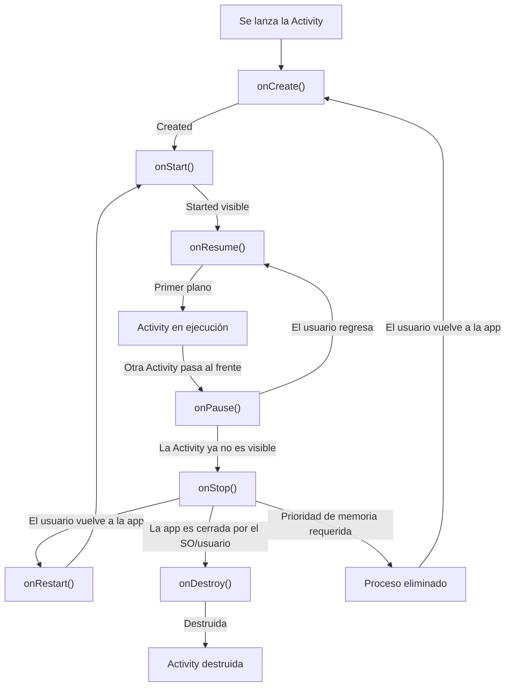
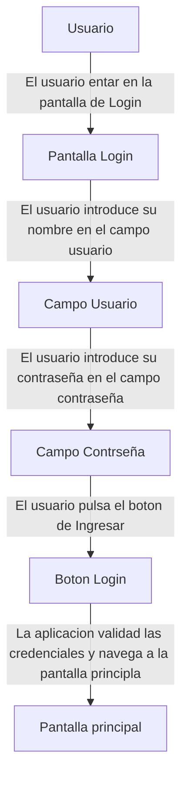
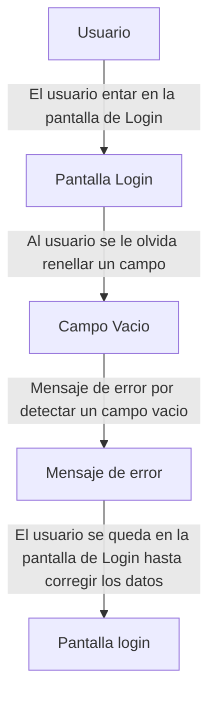
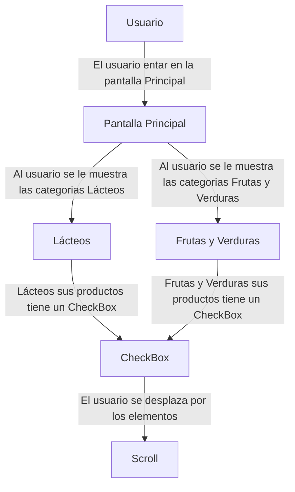
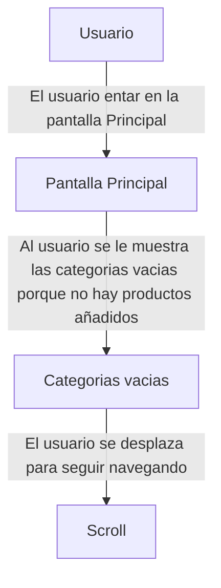
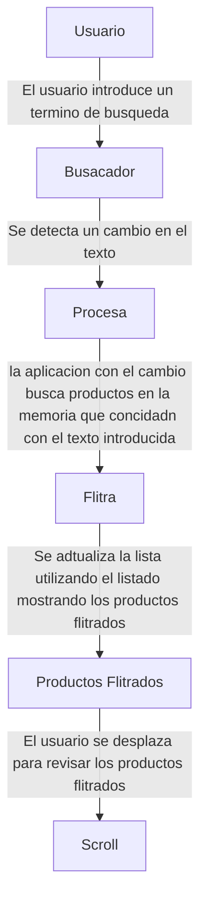
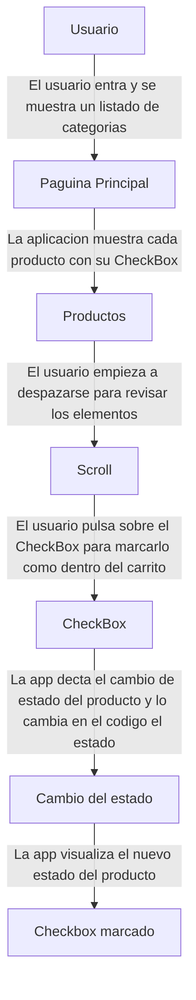

# MarketList

## Indice
1. [Análisis del Desarrollo Móvil](##1-análisis-del-desarrollo-móvil)
2. [Especificación de la App](##2-especificación-de-la-app)
3. [Entorno de Desarrollo](#3-entorno-de-desarrollo)
4. [Recursos de la Aplicación](#4-recursos-de-la-aplicación)
5. [Cómo Ejecutarla](#5-cómo-ejecutarla)
6. [Capturas de Pantalla](#6-capturas-de-pantalla)
7. [Bibliografía y Fuentes](#7-bibliografía-y-fuentes)

---

## 1. Análisis del Desarrollo Móvil
A la hora de realizar una aplicacion tenemos que analizar donde vamos a realizarla.

Si queremos que esta se realize en un movil tenemos que analizar como seria el desarrollo por ello trataremos los siguientes puntos:

### 1. Ventajas e Inconvenientes

#### Ventajas
Tenemos contemplar las ventajas que octendremos por decidir el desarrollo móvil:

- **Movilidad:** Al tener la aplicacion en el moviel el usuario puede utilizar la aplicacion en cualquier momento.
- **Esperiencia Táctil:** La interfaz al estar adactada a la esperiencia tactil mejora la esperiencia del usuaria en muchos casos.

### Inconvenientes
A la hora de desarrollar para dispositivos móvil frente al desarrollo de escritorio tenemos que tener en cuenta las siguientes limitaciones:
- **Batería:** Una desventaja cuentan los móviles se trata de que tienen energía limitada por que depende de una batería por lo que hay que tener en cuenta que mayor será de la energía si tenemos muchas aplicaciones o si la aplicación necesita más recursos por lo que necesita más batería. Sin embargo, esto cuenta con la ventaja de que se evitan los procesos en segundo plano innecesarios para ahorrar la batería.
- **Memoria:** En los móviles contamos con una memoria RAM limitada es verdad que esto ha mejorado actualmente pero esto no quita que la subida de los precios por esto mismo.
- **Pantalla:** En los dispositivos móviles contamos con una pantalla más pequeña por lo que estamos más limitados a la hora de mostrar la aplicación. Hay situaciones en las que opciones que se presentan en el escritorio que por tema de espacio no están en la aplicación.
- **Entrada táctil:** En el móvil estamos limitados a que las zonas de pulsación sean iguales o superiores a 48 dp esto es porque estamos trabajando con los dedos por lo que tiene que tenemos que asegurarnos que sea posible el pulsarlo.

### 2. Elección tecnológica
| Criterio           | Nativo	| Híbrido | 	Multiplataforma                                 |
|--------------------| --- | --- |--------------------------------------------------| 
| Lenguaje           | Java/Kotlin | HTML/CSS/JS | JavaScript                                       |
| Rendimiento        | Máximo | Bajo | Alto                                             |
| Acceso al Hardware | Es directo | Mediante plugins y wrappers (limitado) | MAlto, mediante plugins e integraciones nativas. |
| Coste | Gran coste | Menor coste por lo que menor tiempo de desarrollo | Coste medio/bajo porque se reutiliza el código.  |
| Ejemplo Framework | Android Studio | Ionic | Flutter |

#### Justificación
Para la aplicación CheckList tenemos que decidir en cual vamos a realizar el desarrollo, hemos decidido realizarlo en Android Studio. Estas son algunas de las razones:
- El acceso a hardware es directo por lo que eliminamos la traducción de los traductores de los framework que se utilizan en los híbridos o en las multiplataformas. Necesitamos esta rapidez porque al tratarse de una lista de la compra esta tiene que ser instantánea a la hora de marcar y desmarcar los productos. Con Android Studio conseguimos esa fluidez.
- Queremos que el consumo de la batería sea lo mínimo posible porque al ser una aplicación que se consulta frecuentemente cuando se está en el supermercado no puede suponer un gran consumo de la batería. Con Android Studio al tener una arquitectura nativa se gestiona la memoria RAM y el procesador por lo que el consumo sería mínimo.

### 3. Ciclo de vida de una Activity

#### Descripciones de 3 escenarios
Ahora que tenemos claro el ciclo de vida podemos saber dónde cómo reacciona a las siguientes situaciones.

##### El usuario recibe una llamada
La seduencia de los metodos que atravesaria el usuario son primero onPause() donde la pantalle de llamada se superpone y la activiti pierde el foco.

Una vez que se queda totalmente oculta por la interfaz del telefono pas a onStop().

Con esto la app asegura que el guardado del estado temporar para evitar la perdida de la información.

Cuando se termina la llama y se regresa a la app esta se ejecuta con un onRestart() que comienza un onStart() y realizado un onResume() devolviendo la pantalla sin que los datos se pierdan.

##### El usuario gira el móvil
El cambio de la orientacion hace que el android destruya la Activity actual por lo que la secuencia de los métodos son primero onPause() y onStop() para guardar los datos y continua con onDestroy().ç

Nada mas destruida inmediatamente la Activiti se crea desde cero y se ejecuta onCreate(), onStart() y onResume() para cargar el layout corretamente a la nueva orientación.

##### El usuario pulsa el botón Atrás
El usuario lo comienza al cerrar la pantalla actual, por lo que la Activiti pierde la interacion y visibilidad por lo que pasa por onPause() y onStop() para guardar los datos.

Y por ultimo se destruye con onDestroy() por lo que si el usuario esta en la pantalla principal esta se saldra de la aplicación.

## 2. Especificación de tu app

### 1. Idea y Público Objetivo
#### Idea 
MarketList es una aplicación móvil nativa diseñada en android Studio diseñada para organizar los productos necesarios de tu lista de la compra. Con esta aplicación los usuarios puede planificar los productos que se necesitan adquirir y organizarlos por categorias y poder marcarlos una vez odtenidos en tiempo real.

#### Público Objetivo
Adultos y jovenes la fanja de edad seria de entre 17 a 75 que tiene la capacidad de realizar las compras periodicamente en el hogar, ellos valoran la rapidez y la agilidad con la que peuden realizar agulizar un proceso rutinario ayudando a evitar olvidos.

#### 3 objetivos
Aqui planteamos 3 objetivos medibles para el funcionamiento de la aplicación.
- **Tiempo de acceso e inicio de sesión:** El usuario puede completar la autenticación y el ingreso de la pantalla principal en menos de 15 segundos.
- **Efectividad de busqueda:** Garantiza wue el filtrado de los producto para añadirlos a la lista devuelva resultados en menos de 3 segundos.
- **Optimitación de recursos:** El consumo de la memoria RAM sea inferios de 50 MB mientras se interactua continuamente con la aplicación.

### 2. Requisitos funcionales
Aunque estan los requisitos funcionales que tiene mi aplicación.

| RF   | DESCRIPCIÓN | PRIORIDAD |
|------| --- | --- |
| RF-1 | El usuario podra iniciar sesión en la app introduciones su nombre de usuario y contraseña en el Login. | Alta |
| RF-2 | La pantalla principal se mostrara la lista de los productos por categorias | Alta |
| RF-3 | El usuario puede buscar los producto y flitrar mediante un buscador | Medio |
| RF-4 | La aplicacion se puede mostrar en español y ingles | Media |
| RF-5 | El usuario puede marcar como completada los productos de la lista mediantes estos este en el carrito | Baja |

### 3. Requisitos No funcionales
- **RNF-01 (Usabilidad):** Todos los elementos de la aplicación que son interactivos cuentan con una zona minima de 48dp x 48dp para asegurar el facil uso con los dedos
- **RNF-02 (Compatibilidad):** La aplicación como minimo tiene que ser Android 7.0 Nougat (API 24), si se elige no es necesario que se tenga que recurir a librerias de soporte.
- **RNF-03 (Rendimiento):** La pantalla de carga iniciara y estara todos sus elementos visuales inferior a 1,5 segundos.
- **RNF-04 (Mantenibilidad y Arquitectura):** Todos los colores estan definidos en los archivos correspondientes es su carpeta.

### 4. Casos de Uso
Este seria el diagrama  de los casos de uso que tendria mi aplicación:

#### Ficha caso 1: Iniciar Sesion
| Campo             | Detalle                                            |
|-------------------|----------------------------------------------------|
| Nombre del Caso   | CU-01: Iniciar Sesion                              |
| Actor             | Usuario                                            | 
| Precondición      | La aplicacion se encuentra en la pantalla de login |
| Postcondición     | El usuario accede con exito                        |

- Flujo principal

- Flujo alternativo

#### Ficha caso 2: Consultar Lista de Compras                   |

| Campo             | Detalle                                             |
|-------------------|-----------------------------------------------------|
| Nombre del Caso   | CU-02: Consultar Lista de Compras                   |
| Actor             | Usuario                                             | 
| Precondición      | La aplicacion se encuentra en la pantalla de Inicio |
| Postcondición     | La lista es visible y se puede interartuar con ella |

- Flujo principal

- Flujo alternativo

#### Caso 3: Buscar Producto

#### Caso 4: Marcar Producto como Comprado

## 3. Entorno de desarrollo
### Dispositivos 
Los dos dispositivos virtuales que he eligido: 

| DISPOSITIVOS | TIPO              | RESOLUCIÓN  | DPI     | API     | SISTEMA OPERATIVO |
|--------------|-------------------|-------------|---------|---------|-------------------| 
| Pixel 8      | Movil: Smartphone | 1080 X 2400 | 420 dpi | API37.2 | Android 17.0      |
| Pixel Table  | Tablet            | 2560 X 1600 | 320 dpi | API35   | Android 15.0      |

### Ejecución
Aquí podemos ver como se ven la aplicación ejecutada:

1. Movil: Pixel 8

**Pantalla Login**

**Pantalla Principal**

---

2. Tablet: Pixel Table

**Pantalla Login**

**Pantalla Principal**

### Estructura del proyecto
El proyecto sigue la siguiente estructura:
Toda la estructura esta dentro de una carpeta llamada app.
Dentro de app esta las siguientes carpetas: sampledata, manifests, kotlin+java, res y KeepRules

La carpeta manifests continen un archivo importante llamado AndroidManifest.xml
AndroidManifest.xml es un archivo de configuración global del sistema es esencial para la aplicación de las dos actividades 

La siguiente carpeta kotlin+java dentro se encuentra la carpeta es.medac.paularivasgonzalez.app donde se guarda las clases javas LoginActivity.java y MainActivity.java.

La carpeta res(Recursos de la aplicación) Almacena todos los recursos de la aplicación que son los siguientes archivos:
- **drawable:** Contiene las imágenes gráficos de la app: img_logo.png y ic_cart.xml que son las dos imágenes que he creado.
- **layout:** Contiene los diseños XML de las pantallas: activity_login.xml y activity_main.xml
- **mipmap:** Almacena todos los iconos adaptativos de la app
- **values:** Esta carpeta contiene los archivos estáticos como: colors.xml(Declarar la paleta de colores) themes.xml (Declarar los estilos) y strings.xml (Declara textos para reutilizar y en otros idiomas).

La última carpeta importante es la Gradle Scripts donde los archivos de configuración y automatización de la compilación.

Android aplicada la separación entre el funcionamiento java que es donde se controla el comportamiento ejecutable y interacción del usuario (Activity (Java)) y la interfaz del usuario donde se define de forma declarativa el aspecto visual de la pantalla (Layout (XML) en res/layout/).

Estas dos carpetas se vinculan en el metodo onCreate() de la clase Java donde se vinculan las clases java con su xml y al ejecutarse la clase java puede controlar e interactuar con los gráficos. 

## 6. Bibliografia
- https://developer.android.com/guide/components/activities/activity-lifecycle?hl=es-419
- https://developer.android.com/guide/components/fundamentals?hl=es-419