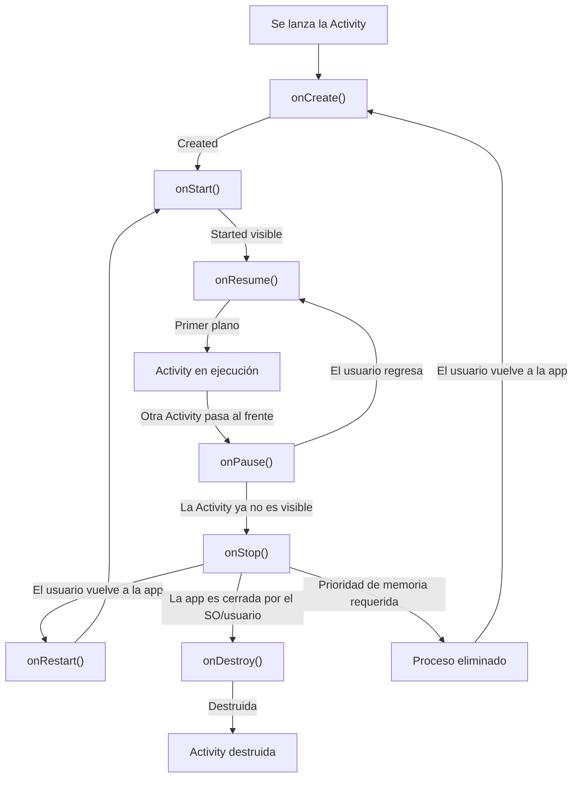

# MarketList

## Indice
1. [Análisis del Desarrollo Móvil](#1-análisis-del-desarrollo-móvil)
2. [Especificación de la App](#2-especificación-de-la-app)
3. [Entorno de Desarrollo](#3-entorno-de-desarrollo)
4. [Recursos de la Aplicación](#4-recursos-de-la-aplicación)
5. [Cómo Ejecutarla](#5-cómo-ejecutarla)
6. [Capturas de Pantalla](#6-capturas-de-pantalla)
7. [Bibliografía y Fuentes](#7-bibliografía-y-fuentes)

---

## 1. Análisis del Desarrollo Móvil
A la hora de realizar una aplicacion tenemos que analizar donde vamos a realizarla.

Si queremos que esta se realize en un movil tenemos que analizar como seria el desarrollo por ello trataremos los siguientes puntos:

### 1. Ventajas e Inconvenientes

#### Ventajas
Tenemos contemplar las ventajas que octendremos por decidir el desarrollo móvil:

- **Movilidad:** Al tener la aplicacion en el moviel el usuario puede utilizar la aplicacion en cualquier momento.
- **Esperiencia Táctil:** La interfaz al estar adactada a la esperiencia tactil mejora la esperiencia del usuaria en muchos casos.

### Inconvenientes
A la hora de desarrollar para dispositivos móvil frente al desarrollo de escritorio tenemos que tener en cuenta las siguientes limitaciones:
- **Batería:** Una desventaja cuentan los móviles se trata de que tienen energía limitada por que depende de una batería por lo que hay que tener en cuenta que mayor será de la energía si tenemos muchas aplicaciones o si la aplicación necesita más recursos por lo que necesita más batería. Sin embargo, esto cuenta con la ventaja de que se evitan los procesos en segundo plano innecesarios para ahorrar la batería.
- **Memoria:** En los móviles contamos con una memoria RAM limitada es verdad que esto ha mejorado actualmente pero esto no quita que la subida de los precios por esto mismo.
- **Pantalla:** En los dispositivos móviles contamos con una pantalla más pequeña por lo que estamos más limitados a la hora de mostrar la aplicación. Hay situaciones en las que opciones que se presentan en el escritorio que por tema de espacio no están en la aplicación.
- **Entrada táctil:** En el móvil estamos limitados a que las zonas de pulsación sean iguales o superiores a 48 dp esto es porque estamos trabajando con los dedos por lo que tiene que tenemos que asegurarnos que sea posible el pulsarlo.

### 2. Elección tecnológica
| Criterio           | Nativo	| Híbrido | 	Multiplataforma                                 |
|--------------------| --- | --- |--------------------------------------------------| 
| Lenguaje           | Java/Kotlin | HTML/CSS/JS | JavaScript                                       |
| Rendimiento        | Máximo | Bajo | Alto                                             |
| Acceso al Hardware | Es directo | Mediante plugins y wrappers (limitado) | MAlto, mediante plugins e integraciones nativas. |
| Coste | Gran coste | Menor coste por lo que menor tiempo de desarrollo | Coste medio/bajo porque se reutiliza el código.  |
| Ejemplo Framework | Android Studio | Ionic | Flutter |

#### Justificación
Para la aplicación CheckList tenemos que decidir en cual vamos a realizar el desarrollo, hemos decidido realizarlo en Android Studio. Estas son algunas de las razones:
- El acceso a hardware es directo por lo que eliminamos la traducción de los traductores de los framework que se utilizan en los híbridos o en las multiplataformas. Necesitamos esta rapidez porque al tratarse de una lista de la compra esta tiene que ser instantánea a la hora de marcar y desmarcar los productos. Con Android Studio conseguimos esa fluidez.
- Queremos que el consumo de la batería sea lo mínimo posible porque al ser una aplicación que se consulta frecuentemente cuando se está en el supermercado no puede suponer un gran consumo de la batería. Con Android Studio al tener una arquitectura nativa se gestiona la memoria RAM y el procesador por lo que el consumo sería mínimo.

### 3. Ciclo de vida de una Activity

#### Descripciones de 3 escenarios
Ahora que tenemos claro el ciclo de vida podemos saber dónde cómo reacciona a las siguientes situaciones.

##### El usuario recibe una llamada
La seduencia de los metodos que atravesaria el usuario son primero onPause() donde la pantalle de llamada se superpone y la activiti pierde el foco.

Una vez que se queda totalmente oculta por la interfaz del telefono pas a onStop().

Con esto la app asegura que el guardado del estado temporar para evitar la perdida de la información.

Cuando se termina la llama y se regresa a la app esta se ejecuta con un onRestart() que comienza un onStart() y realizado un onResume() devolviendo la pantalla sin que los datos se pierdan.

##### El usuario gira el móvil
El cambio de la orientacion hace que el android destruya la Activity actual por lo que la secuencia de los métodos son primero onPause() y onStop() para guardar los datos y continua con onDestroy().ç

Nada mas destruida inmediatamente la Activiti se crea desde cero y se ejecuta onCreate(), onStart() y onResume() para cargar el layout corretamente a la nueva orientación.

##### El usuario pulsa el botón Atrás
El usuario lo comienza al cerrar la pantalla actual, por lo que la Activiti pierde la interacion y visibilidad por lo que pasa por onPause() y onStop() para guardar los datos.

Y por ultimo se destrulle con onDestroy() por lo que si el usuario esta en la pantalla principal esta se saldra de la aplicación.

